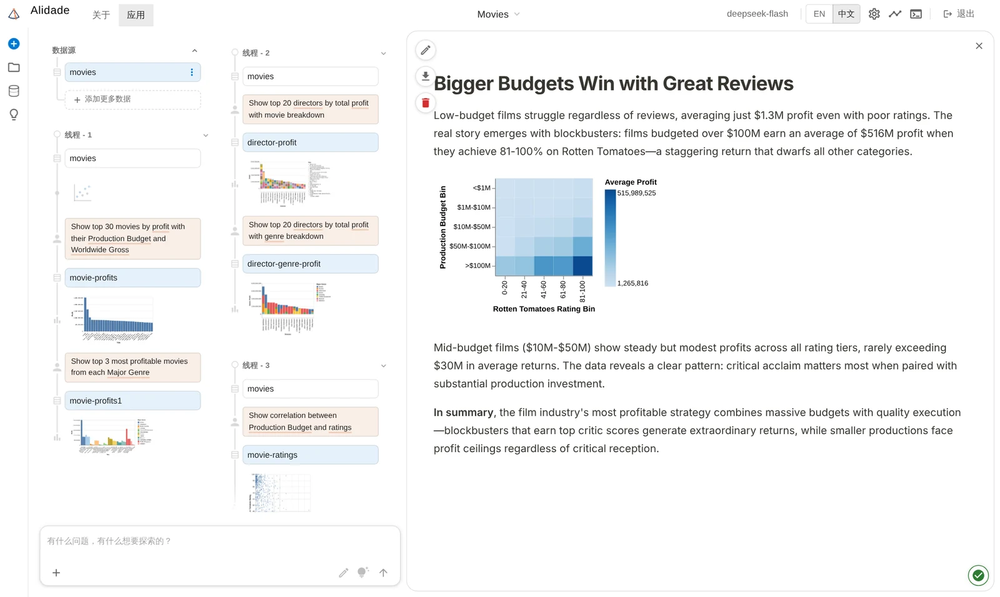
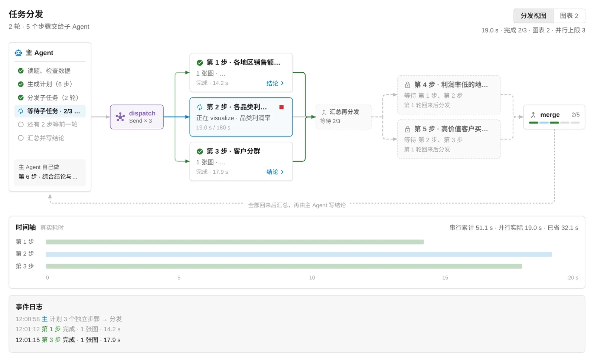
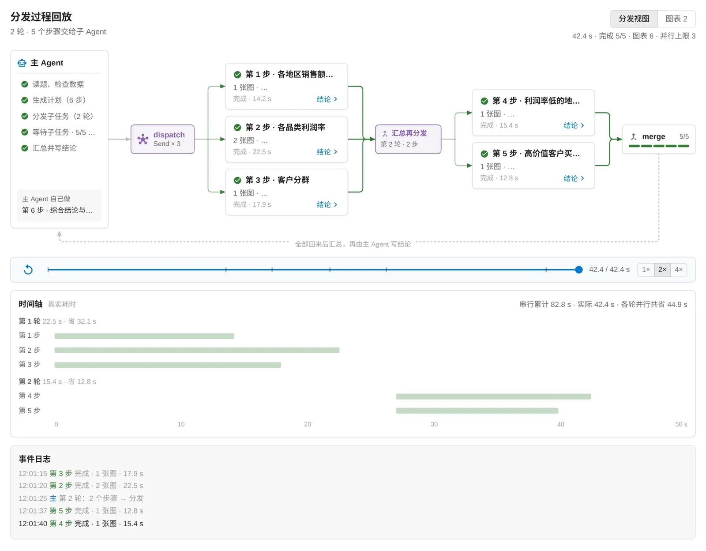

<h1 align="center">
  <br>
  Alidade
</h1>

<p align="center">
  瞄准问题，读懂数据。 · Aim at the question, read the data.
</p>

<p align="center">
  <a href="LICENSE"></a>&ensp;
  &ensp;
  &ensp;
  
</p>

**Alidade（照准仪）**是测量仪器上用来瞄准目标、读取角度的部件。这个项目是一个在本机运行的 AI 数据分析 Agent：你提出问题，它先列出分析计划，再写代码探索数据、生成图表，必要时停下来问你，并在同一次运行里继续。

> Alidade 基于 [Microsoft Data Formulator](https://github.com/microsoft/data-formulator)（MIT 协议）改造。数据连接、数据线程（Data Threads）、图表渲染等基础能力来自上游项目；Agent 框架和工作流程是重写的，具体见下文的[与上游的区别](#与上游的区别)。

## 截图

**数据线程与分析结论**：左侧每个线程是一串提问 → 生成的表 → 图表，右侧是 Agent 写的结论和配图。



**分发面板**（并行子 Agent 打开时）：第一轮三个步骤同时进行，第二轮的两个步骤等依赖完成后才分发，时间轴给出串行累计与并行实际耗时。



**回放已结束的运行**：在回答下方点"查看分发过程"，按记录回放每一步的开始和结束。



> 两张分发面板截图用构造的两轮计划渲染（界面和计算逻辑与真实运行相同），数据线程截图是内置的 Movies 示例。

## 主要特性

**分析流程**

- **先规划再执行**：Agent 先用 `update_plan` 列出分析步骤，界面上实时显示进度清单；画出一张图后由代码把对应步骤标为完成，模型不用为更新状态单独调用一次。
- **先澄清再动手**：问题含糊（"最成功的电影"）或涉及投资建议时，先用 `ask_user` 反问，附上它的判断和 2–3 个选项（第一个是推荐）。回答后通过 `run_id` 从 SQLite 检查点恢复，在同一次运行里继续。
- **记住口径**：用户回答过一次"最成功指回报率"，Agent 用 `save_definition` 存下来；之后在同样的数据上再用到这个词，直接沿用并说明"沿用你上次定的口径"。知识面板里可以查看和删除。
- **数据体检**：读表时报告重复行、数字存成文本、日期格式混杂、空值等问题，Agent 先清洗再计算。
- **图表自检**：图表在展示前要通过一组规则检查（未聚合的折线、类别或线条过多、空数据等）。不通过就退回给模型修正，最多重试 2 次。
- **数字溯源**：结论里的每个数字都能追到本次运行打印的结果、图表数据或原始表；评测里统计找不到出处的比例。
- **沙箱执行**：模型写的代码在沙箱里跑——禁止写文件、禁止读工作区以外、禁止起进程和联网，并有内存和时间上限；DuckDB / PyArrow 的原生文件读写也被拦（[docs/sandbox.md](docs/sandbox.md)）。
- **大数据**：行数很多的表不整表读进内存——真实行数和数字统计用 DuckDB 直接从文件算，schema 和样例取抽样，并提示模型用 DuckDB SQL 聚合、只取小结果（`ALIDADE_BIGDATA`，默认开；[docs/plans/large-data.md](docs/plans/large-data.md)）。

**主动发现洞察**

- `find_insights` 不调模型，用统计检验扫描趋势、突变点、组间差异、相关、异常值和集中度，所有检验一起做 Benjamini–Hochberg 校正（错误发现率 5%），只报告效应足够大的结果。聊天框里一键"发现洞察"。

**并行与调度**

- **一次回复调多个只读工具**：查看表结构、跑查询可以在一次模型回复里并发进行（`ALIDADE_PARALLEL_TOOLS`，默认开）。
- **并行子 Agent（实验性，默认关）**：计划步骤带依赖（`depends_on`），互不依赖的步骤用 LangGraph `Send` 分给子 Agent 同时做（`dispatch → subagent × N → merge`）。每个子 Agent 有独立的 Python 会话、图表预算和超时，可以单独停止；每一步完成就写入检查点，进程中途被杀后续跑只重做没完成的步骤。
- **分发面板**：子 Agent 工作时，画布变成实时的分发流程图：每一轮一列，后一轮的步骤在依赖完成前显示为锁住；时间轴给出"串行累计 / 并行实际 / 已省"，标出拖慢整轮的步骤。已结束的回答可以回放分发过程。

**成本与模型**

- **按任务分配模型**：读题、读用户回答、失败后的补救用强模型，常规步骤用同一服务商的小模型或低思考档（`ALIDADE_FAST_MODEL` / `ALIDADE_STRONG_EFFORT` / `ALIDADE_FAST_EFFORT`）；小模型的结论里有找不到出处的数字时，交给强模型重写。
- **上下文压缩**：长分析超过 token 预算时，先裁剪旧的输出，再把更早的步骤压缩成摘要。
- **任意模型**：通过 LiteLLM 接入 OpenAI、Anthropic、Azure、Ollama、DeepSeek 或任何兼容 OpenAI 协议的服务。

**可观测与集成**

- **运行轨迹**：每次运行记录每次模型调用（模型、分工档位和原因、耗时、token、缓存命中）、工具调用、图表、自检和子 Agent，工具栏里有时间线查看器。
- **LangSmith（可选）**：把 LangGraph 节点和每次模型调用上报到 LangSmith；回答下方的 👍/👎 记为这次运行的反馈；评测结果可以作为实验上传，在网页上并排对比（[docs/langsmith.md](docs/langsmith.md)）。
- **MCP 服务器**：`python -m alidade.mcp_server`，在 Claude Desktop、Cursor 里直接加载本地文件、提问（图表以 PNG 返回）、回答反问、扫描洞察（[docs/mcp.md](docs/mcp.md)）。
- **不打断的界面**：Agent 工作时输入框可用，消息进入可编辑的队列；数据线程可以折叠，长对话里也能找到之前的分析。

## 快速开始

需要 Python 3.11+、Node.js 18+、[uv](https://docs.astral.sh/uv/)（推荐）和 Yarn 1.x。

**Windows (PowerShell)**

```powershell
# 后端
uv venv
.\.venv\Scripts\activate
uv pip install -e .

# 前端（构建到 py-src/alidade/dist，由后端直接提供）
yarn install
yarn build

# 配置模型：复制模板后填入 API Key
copy .env.template .env

# 启动，然后打开 http://localhost:5567
alidade
```

**macOS / Linux**

```bash
uv venv && source .venv/bin/activate && uv pip install -e .
yarn install && yarn build
cp .env.template .env
alidade
```

开发时可以用 `yarn start` 启动带热更新的前端，再用 `alidade --dev` 启动后端。更多选项见 [DEVELOPMENT.md](DEVELOPMENT.md)。

### 配置

| 配置 | 说明 |
|---|---|
| `OPENAI_API_KEY` / `OPENAI_MODELS` 等 | 服务端预置的模型，见 `.env.template`；也可以在界面里添加自定义模型 |
| `ALIDADE_HOME` | 数据目录，默认 `~/.alidade`（会话、工作区、日志、检查点） |
| `ALIDADE_AGENT_CONTEXT_BUDGET` | 上下文压缩的 token 预算，默认 60000 |
| `SANDBOX` | 代码执行方式：`local`（默认，进程内沙箱）或 `docker`（容器隔离） |
| `ALIDADE_SANDBOX_TIMEOUT` | 单次代码执行的墙钟上限，默认 120 秒 |
| `ALIDADE_SANDBOX_MEMORY_MB` | 单个工作进程的内存上限，默认 4096（`0` = 不限） |
| `ALIDADE_SUBAGENTS` | 设为 `1` 打开并行子 Agent（默认关）；`ALIDADE_MAX_SUBAGENTS` 同时运行几个（默认 3）。也可以在"设置 → Agent"里按次调整 |
| `ALIDADE_FAST_MODEL` | 按任务分配模型：常规步骤用的小模型（同一服务商） |
| `ALIDADE_DEFINITIONS` | 记住用户口径，默认开（`0` 关闭） |
| `ALIDADE_LANGSMITH` | 设为 `1` 并配好 `LANGSMITH_API_KEY` 后，把 LangGraph 节点和每次模型调用上报到 LangSmith，默认关闭，见 [docs/langsmith.md](docs/langsmith.md) |
| `ALIDADE_BIGDATA` | 大表走 DuckDB（抽样建摘要 + 用 SQL 聚合），默认开；`ALIDADE_BIGDATA_ROWS`（阈值，默认 20 万）、`ALIDADE_BIGDATA_SAMPLE`（抽样行数，默认 5 万） |

## 架构

```
用户提问 ──► prepare ──► agent ⇄ tools（只读工具：查看数据、执行探索代码、更新计划）
                          │
                          ▼
                         act（visualize / ask_user / write_report …）
                          │
              ┌───────────┼──────────────┬─────────────────────────────┐
              ▼           ▼              ▼                             ▼
            agent     await_user       finish            dispatch ─Send─► subagent × N ─► merge
         （继续下一步） （interrupt 暂停） （输出结论）      （计划里有 ≥2 个互不依赖的步骤时，可再分发下一轮）
```

- **后端**：Flask + LangGraph（`py-src/alidade/analyst/engine/`）。模型调用用 LiteLLM，状态检查点存在 SQLite，流式事件用 NDJSON 推给前端。
- **前端**：React + Redux + MUI，图表基于 Vega-Lite / [Flint](https://microsoft.github.io/flint-chart/)。
- **技能**：Agent 的能力按技能组织（core / report / data-loading），每个技能由 `SKILL.md` 和 `tools.json` 描述。

| 模块 | 作用 |
|---|---|
| `analyst/engine/graph.py` | 状态图节点与路由 |
| `analyst/engine/planning.py` | `update_plan` 工具与计划事件 |
| `analyst/engine/chart_check.py` | 图表自检规则 |
| `analyst/engine/execution.py` | 持久化探索会话与可视化执行 |
| `analyst/engine/compression.py` | 上下文压缩 |
| `analyst/engine/checkpoints.py` | SQLite 检查点（暂停恢复、中断续跑） |
| `analyst/engine/subagent.py` | 子 Agent 运行器 |
| `analyst/engine/routing.py` | 按任务分配模型 |
| `analyst/engine/number_check.py` | 结论数字溯源 |
| `analyst/engine/table_access.py` | 大表：不整表载入的摘要与聚合 |
| `analyst/engine/insights.py` | 统计洞察扫描 |
| `mcp_server.py` | MCP 服务器 |
| `src/app/dispatchView.ts` | 分发面板的状态（纯函数，实时和回放共用） |

## 评测

`eval/` 里有一套用真实模型跑的评测：64 道题、14 类（查询、趋势、多步、陷阱图、模糊、必须先澄清、脏数据、多表关联、数字溯源、多角度、三步计划、口径记忆、洞察、大数据），统计成功率、结论正确率、反问行为、token、缓存命中、耗时和估算费用，并能和改造前的版本自动对比；带隐藏意图的题可以由 LLM 扮演用户回答反问。用法见 [eval/README.md](eval/README.md)，分析报告见 `eval/analysis-*.md`。

主要结果（DeepSeek deepseek-flash，每题 2–3 次，样本不大，引用时注明）：

| 改动 | 结果 |
|---|---|
| 先澄清再动手（13 道模糊 / 澄清 / 脏数据题） | 出图前先反问 6% → 75%；必须先澄清的题 17% → 67%；用户确认方向前的 token −54% |
| 模拟用户（按隐藏的真实意图判分） | 答对 75% → 100%，总 token −31%，耗时 −15% |
| 数据体检 | 脏数据题成功率 80% → 100% |
| 计划随出图自动推进 | LLM 调用 −15%，总 token −18%，正确率不变 |
| 记住口径（同一用户第二次问） | 又反问的比例 100% → 25%，第二问 token −24%（8 次运行） |
| 洞察扫描（合成数据基准，50 张表） | 规律明显时 6 类全部找到、噪声列零误报；完全没有规律的表 1/50 报了 1 条 |
| 思考强度（难题组，全部 low 对比默认 high） | 正确率不变，输出 token −25%，耗时 −14% |
| 并行子 Agent（8 道多角度 / 三步题 × 3） | 正确率不变，但平均耗时没有下降、token +38%：子 Agent 冷启动和汇总的开销抵消了并行节省，所以默认关闭（分析见 [docs/plans/parallel-subagents.md](docs/plans/parallel-subagents.md)） |
| 大表走 DuckDB（300 万行，3 题 × 2，开 vs 关） | 正确率不变 100%、LLM 评分 5.0；平均每题耗时 57s → 32s（约 1.8×）；总 token 持平甚至略增（+7%）——省的是服务端时间 / 内存，不是模型 token（[docs/plans/large-data.md](docs/plans/large-data.md)） |

## 测试

```bash
python -m pytest tests/backend      # 后端
yarn test                           # 前端（vitest）
```

## 与上游的区别

相对于 Data Formulator 0.8.0b1（完整列表见 [CHANGELOG.md](CHANGELOG.md)）：

- Agent 循环用 LangGraph 重写，新增规划、图表自检、持久化会话、上下文压缩，暂停与恢复改为按 `run_id` 从检查点恢复。
- 新增先澄清、口径记忆、数据体检、数字溯源、统计洞察扫描、按任务分配模型、并行子 Agent 与分发面板、运行轨迹、LangSmith 集成、MCP 服务器和评测框架。
- 反问附带上下文和推荐选项；Agent 运行时输入框可用，消息可以排队。
- 修复了空工作区中运行 Agent 的问题。
- 删除了桌面打包、Azure Blob 工作区、Kusto 的 Microsoft 登录、Superset 连接器和上游的 CI 与宣传素材。
- 项目更名：包名 `alidade`、命令 `alidade`、环境变量 `ALIDADE_*`、数据目录 `~/.alidade`。

### 从旧版本迁移

- 旧的环境变量名 `DATA_FORMULATOR_*` 和 `DF_*` 仍然有效，新名字优先。
- 第一次启动时，如果只有 `~/.data_formulator`，会自动复制到 `~/.alidade`，旧目录保留作为备份。
- 包名变了，需要重新安装一次：`uv pip install -e .`。

## 致谢与许可

Alidade 基于 [Microsoft Data Formulator](https://github.com/microsoft/data-formulator) 开发，原项目以 MIT 协议发布，版权归 Microsoft Corporation 所有。本项目同样以 MIT 协议发布，见 [LICENSE](LICENSE)。上游的 README 和更新记录保存在 [docs/upstream/](docs/upstream/)。
