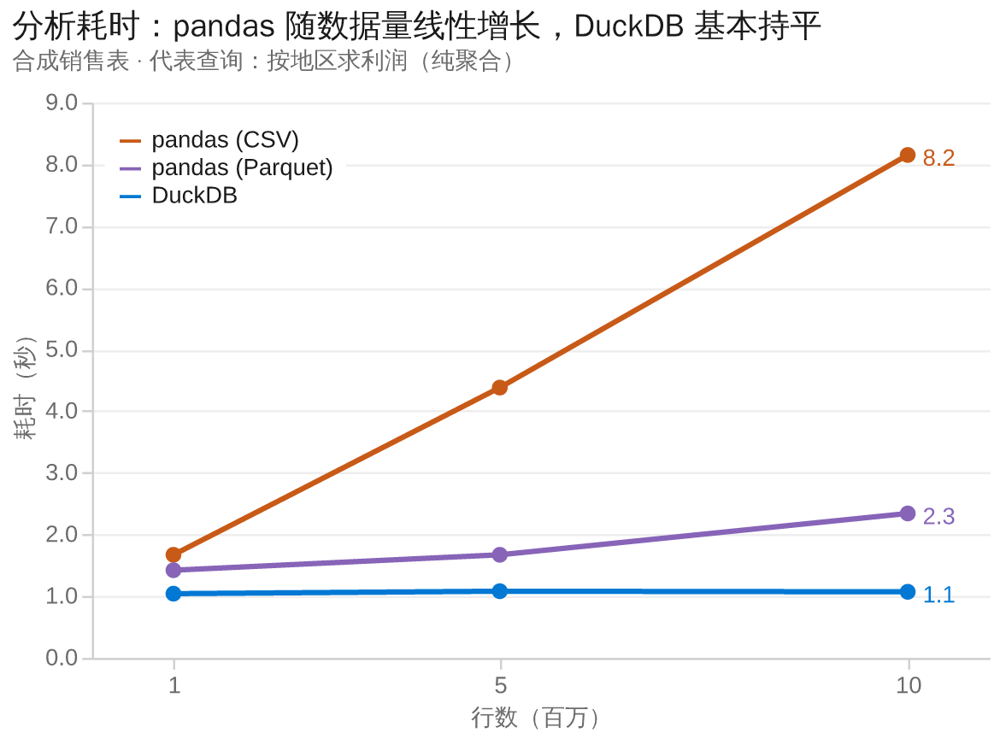
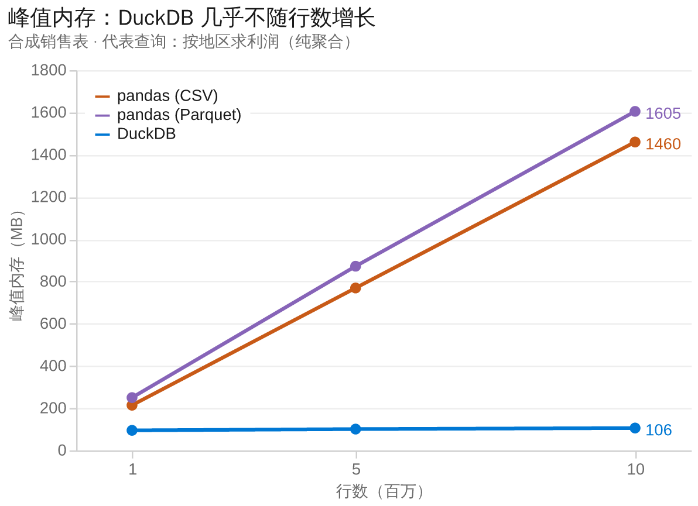

# 大数据：用 DuckDB 流式聚合替代 pandas 整表载入

## 问题

分析 Agent 现在用 pandas 把整张表读进内存再分析。几百万行以上，又慢又占内存，上千万行会把内存吃光。但用户的问题几乎都是聚合（按组求和、筛选后统计、Top-N），**结果只有几行**，哪怕输入是千万行。为这几行结果把整表读进 pandas，时间和内存全花在不需要的行上。

## 方案

- 加载大文件时转成 Parquet，给模型的是**元信息和抽样**（行数、列、类型、每列范围和样例），不是整表。
- 探索和聚合用 DuckDB 直接在 Parquet 上跑，只把**聚合后的小结果**交给模型和画图。
- 设行数阈值：小表走原来的 pandas 路径不变，大表自动走 DuckDB。
- 取舍：大表默认不整表进内存后，「对全表做任意 pandas 操作」会受限，改为引导模型用 DuckDB 的 SQL 聚合；需要看具体几行时用抽样。

## 已量：耗时与内存（`eval/bench_large_data.py`，不需要模型）

合成销售表，三类分析（按地区求利润、筛选后按品类、消费前 20 的客户），对比「pandas 整表读入」与「DuckDB 直接查」。下面是一次真实运行（28 核；`python eval/bench_large_data.py --rows 1_000_000 5_000_000 10_000_000`）。每个（引擎 × 查询）在自己的子进程里量峰值内存。

代表查询（按地区求利润，纯聚合）随行数的耗时和峰值内存，配色沿用项目默认图表风格：





完整数据：

**10M 行**（Parquet 90 MB / CSV 475 MB）

| 查询 | pandas(CSV) 秒 | pandas(Parquet) 秒 | DuckDB 秒 | pandas 峰值 MB | DuckDB 峰值 MB |
|---|--:|--:|--:|--:|--:|
| 按地区求利润 | 8.15 | 2.34 | 1.07 | 1460–1605 | 106 |
| 筛 West 后按品类 | 9.20 | 2.43 | 1.15 | 1459–1588 | 109 |
| 消费前 20 客户 | 8.50 | 2.23 | 1.32 | 1459–1602 | 349 |

**5M 行**（Parquet 45 MB / CSV 237 MB）

| 查询 | pandas(CSV) 秒 | pandas(Parquet) 秒 | DuckDB 秒 | pandas 峰值 MB | DuckDB 峰值 MB |
|---|--:|--:|--:|--:|--:|
| 按地区求利润 | 4.38 | 1.67 | 1.08 | 769–872 | 101 |
| 筛选后按品类 | 4.37 | 1.73 | 1.13 | 769–883 | 103 |
| 消费前 20 客户 | 4.36 | 1.69 | 1.26 | 769–881 | 186 |

**1M 行**（Parquet 9 MB / CSV 47 MB）：三引擎都在 1–2 秒、200–250 MB，差距要到数百万行才拉开。

**读法：**
- 用户上传大 CSV（最常见）时，DuckDB 比 pandas 读 CSV 快 **约 7–8 倍**（10M）、**约 4 倍**（5M）。
- 对 Parquet，DuckDB 约 **2 倍**快。
- 内存是最大的差距：pandas 随行数线性涨（10M 约 1.5 GB），**DuckDB 基本持平在约 100 MB**，聚合类查询省 **约 14 倍**（10M）。唯一例外是「前 20 客户」要按 5 万个客户分组，DuckDB 涨到约 0.35 GB，仍远低于 pandas。
- 两种方式返回给模型的结果都只有 5–20 行——这正是「只把聚合结果交给模型」的意义。

复现（不需要 API Key）：`python eval/bench_large_data.py --rows 1_000_000 5_000_000 10_000_000`（`--out` 存成文件，`--keep` 保留数据文件）。

## 已做：接进分析流程（`ALIDADE_BIGDATA`，默认开）

`py-src/alidade/analyst/engine/table_access.py`：一张表的行数 ≥ `ALIDADE_BIGDATA_ROWS`（默认 20 万）时算大表。

- **建表摘要不再整表载入**。两个构建表上下文的地方（`agents/context.py` 的 `build_lightweight_table_context`、`agents/agent_utils.py` 的 `assemble_table_summary`）原本都 `read_data_as_df` 读整张表来算行数、schema、样例、数字统计。现在大表改为：
  - 真实行数走 Parquet footer / DuckDB `COUNT(*)`（毫秒级，不载入）；
  - schema 和样例值从前 `ALIDADE_BIGDATA_SAMPLE`（默认 5 万）行的 DuckDB 抽样；
  - 数字列的 min/max/mean 用一条 DuckDB 聚合算**精确值**（不是抽样估计）；
  - 摘要里标注「large table (N rows)」并提示模型用 DuckDB SQL 直接查文件、只取聚合结果。
- **提示模型用 DuckDB 聚合大表**（`skills/core/SKILL.md`）：大表不要整表读进 pandas，用 `duckdb.sql("… FROM 'data/<file>' …").df()` 聚合后只取小结果。
- 小表（低于阈值）或 `ALIDADE_BIGDATA=0` 时，一切走原来的 pandas 路径，行为不变。
- 测试：`tests/backend/agents/test_table_access.py`（10 项，含「大表绝不被整表载入」的断言、精确数字统计、开关与阈值、CSV 行数）。

**已量：建摘要这一步，开 vs 关**（同一张合成表，只测 `build_lightweight_table_context`）

| 行数 | 关（整表载入） | 开（抽样 + 元数据） |
|---|--:|--:|
| 3M | 13.2 s | 3.6 s（约 3.7 倍） |
| 10M | 36.6 s | 4.2 s（约 8.8 倍） |

（峰值内存这里被同进程里的造数据占满，不干净；内存的对比看上面 pandas vs DuckDB 的基准。）

## 已量：端到端对比（deepseek-flash，300 万行表，6 次运行）

复现（需要模型 Key）：

```powershell
python eval\data\make_large.py              # 生成 eval\data\large_sales.parquet（约 30 MB，已 gitignore）
$env:ALIDADE_BIGDATA='0'; .\eval\eval.ps1 new -Only bigdata -Tag bigdata-off -Jobs 1
$env:ALIDADE_BIGDATA='1'; .\eval\eval.ps1 new -Only bigdata -Tag bigdata-on  -Jobs 1
Remove-Item Env:ALIDADE_BIGDATA
```

| 指标 | 关（整表载入） | 开（DuckDB） | 变化 |
|---|--:|--:|--:|
| 结论正确率（有标准答案） | 100% | 100% | 持平 |
| LLM 评分（1–5） | 5.00 | 5.00 | 持平 |
| 平均耗时 | 57.3 s | 32.3 s | **−44%（约 1.8×）** |
| 平均总 token | 87,913 | 94,079 | +7% |
| 总 token 中位数 | 77,352 | 86,310 | +12% |
| 平均工具调用数 | 4.3 | 4.7 | +0.4 |
| 输入 token 缓存命中率 | 96% | 97% | 持平 |

逐题耗时（开启后**每一题都更快**，秒）：

| 题目 | 关 | 开 |
|---|--:|--:|
| region-sales #1 | 41.6 | 22.8 |
| top-category #1 | 37.2 | 31.0 |
| monthly-trend #1 | 43.7 | 30.5 |
| region-sales #2 | 43.1 | 20.0 |
| top-category #2 | 43.2 | 19.5 |
| monthly-trend #2 | 134.9 | 69.8 |

**诚实的结论：**

- **耗时稳定下降**，六题全部更快，合计约 1.8×。主因是建摘要不再整表载入 pandas——这一步 300 万行 13.2 s → 3.6 s，直接从每题的墙上时间里扣掉。
- **正确率、评分不变**，没有因为改走抽样 + 聚合而答错。
- **token 基本持平、甚至略增（+7%）**，不是下降。原因：开和关两种模式最终喂给模型的都是聚合 / 抽样后的小结果（关模式下建摘要虽然整表载入，但放进 prompt 的同样只是样例），所以模型看到的 payload 规模本来就接近；开启后摘要多了「精确数字统计 + 大表提示」，还偶尔多一次工具调用，token 反而微增。**这个特性省的是服务端的时间和内存，不是模型 token——简历和文档都按这个写，不要宣称省 token。**
- 关模式的 134.9 s 异常值把均值拉高了；但即便看中位数 / 逐题，开模式也全面更快。

## 简历可用的表述（按上面的实测数字）

> 针对大表引入 DuckDB 流式聚合替代 pandas 整表载入：千万行数据上，用户上传 CSV 的常见场景单次分析从约 8 秒降到约 1 秒（约 7 倍），峰值内存从约 1.5 GB 降到约 0.1 GB（约 14 倍）且不随行数增长；只把聚合结果交给模型。在 300 万行的端到端评测里，平均每题耗时从 57 秒降到 32 秒（约 1.8×）、结论正确率持平（100%）。配套可复现的耗时 / 内存基准（`eval/bench_large_data.py`）与端到端评测（`eval/questions.yaml` 的 `bigdata` 类）。

注：token 不是卖点——实测开启后总 token 基本持平、略增（+7%），因为两种模式喂给模型的都是聚合后的小结果。简历只写耗时和内存，别写省 token。
